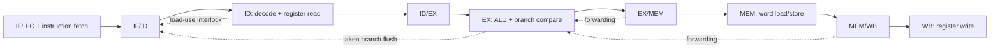

# Five-stage 32-bit RISC-V processor

This university project implements and verifies a single-issue, in-order 32-bit
processor with IF, ID, EX, MEM and WB stages. Its objective is to demonstrate
pipeline overlap, data hazards, forwarding, branch recovery and measured CPI/IPC
in a reproducible SystemVerilog project.

## Supported ISA and architecture

The supported subset is **ADD, SUB, ADDI, LW, SW, BEQ and BNE**. The register
file has 32 32-bit entries; x0 always reads zero and ignores writes. Instruction
and data memories are separate, with aligned word LW/SW accesses.



EX/MEM forwarding has priority over MEM/WB; x0 is excluded and loads are not
forwarded from EX/MEM. A load-use dependency stalls PC and IF/ID for one cycle
and inserts an ID/EX bubble. Branches resolve in EX, redirect the PC when taken,
and flush the two younger slots. Redirect takes priority over a simultaneous
decode stall. See [architecture](docs/architecture.md) and
[implementation](docs/implementation.md) for actual RTL behavior.

Simulation program completion uses explicit `IMEM_PROGRAM_LENGTH`. A canonical
NOP (`0x00000013`) within that range is a valid instruction and retires normally;
fetches beyond the range are invalid NOP bubbles. Validity drains through WB,
while bubbles and flushed instructions do not retire.

## Repository layout

- `rtl/components/` — ALU, memories, register file, decode, forwarding, hazard and PC logic.
- `rtl/pipeline_registers/` — IF/ID, ID/EX, EX/MEM and MEM/WB registers.
- `rtl/riscv_top.sv` — integrated datapath and simulation counters.
- `testbench/` — unit, integration, corner-case and termination regressions.
- `programs/` — benchmark and verification instruction streams.
- `verification/` — performance reporting and corner-program generation.
- `docs/` — architecture, implementation, verification and performance reports.
- `submission/` — final submission reports and captured validation evidence.

## Requirements and installation

Required: GNU Make, Verilator 5.x with `--binary`, `--timing` and `--trace`,
Yosys, and Python 3 (standard library only). GTKWave is optional for waveform
viewing. The tested environment used Verilator 5.054 and Yosys 0.71+; these are
reference versions rather than strict pins. No RISC-V cross-compiler is needed;
the instruction hex files are included.

On macOS with Homebrew, install Verilator and Yosys:

```sh
xcode-select --install
brew install verilator yosys
```

The Xcode Command Line Tools provide the compiler, headers and SDK used by
Verilator `--binary` builds. GTKWave can be installed with MacPorts using
`sudo port install gtkwave`.

On Debian or Ubuntu:

```sh
sudo apt-get update
sudo apt-get install build-essential python3 verilator yosys gtkwave
```

## Build, simulation and verification

Run commands from the repository root (the directory containing the Makefile):

```sh
make help
make build        # compile the integration testbench
make run          # simulate and generate CSV, performance report and graph
make test         # compile and run every unit and integration testbench
make lint         # run Verilator lint
make synth        # run Yosys hierarchy, proc and check passes
make performance  # regenerate report from the latest CSV
make wave         # open the latest processor waveform in GTKWave
```

`make build` only compiles. Run `make run` or `make test` before `make wave` or
`make performance`. `make run` writes actual RTL counter data to
`riscv-processor/simulation/performance.csv`; the Python script generates
`docs/performance_results.md` and `docs/performance_analysis.svg`. These are
simulation measurements, not execution time, clock frequency, hardware speedup
or FPGA timing. Override tool paths as needed, for example
`make lint VERILATOR=/path/to/verilator`.

To generate and inspect the integration waveform:

```sh
make run
make wave
```

The VCD is `riscv-processor/simulation/processor_tb.vcd`. It includes clock and
reset, PC and instruction fetch, pipeline stage state, forwarding selectors,
load-use stalls, branch decisions/flushes, WB data and validity. See
[waveform.md](docs/waveform.md) for signal names and scenarios. No GTKWave
screenshot is included.

`make clean` removes build directories and this flow's known generated
waveforms and performance CSV; it leaves arbitrary VCD files alone.

## Troubleshooting

- If `verilator` or `yosys` is missing, install it or pass its executable with `VERILATOR=...` or `YOSYS=...`.
- For a macOS C++ error such as `cstddef file not found`, install/update Xcode Command Line Tools with `xcode-select --install`. If needed, retry with:
  ```sh
  CXXFLAGS="-isystem $(xcrun --show-sdk-path)/usr/include/c++/v1" make test
  ```
  The same prefix works with `make build` or `make run`.
- If no processor waveform exists, run `make run` or `make test` first.
- If GTKWave cannot start, install it, ensure it is on `PATH`, or set `GTKWAVE=/path/to/gtkwave`; it requires a graphical session.
- Run Make from the repository root so program paths resolve correctly.
- Lint currently reports documented nonfatal warnings; review them separately from the exit status.

## Known limitations

This is a focused subset, not a complete RV32I processor. Other RV32I
instructions, exceptions, interrupts, privilege modes, byte/halfword accesses,
caches, and a full ISS-based comparison are outside scope. Store-data dependency
handling uses the conservative load-use interlock. Yosys checks RTL structure but
does not perform technology mapping or timing closure. No FPGA deployment,
physical timing, power, area or hardware speedup was measured. See
[verification.md](docs/verification.md) for coverage and gaps.

The [submission package](submission/README.md) contains the final reports,
benchmark programs and CSV, test results, synthesis and lint logs, and waveform.
