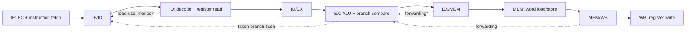

# Five-stage 32-bit RISC-V processor

This university project implements and verifies a single-issue, in-order 32-bit
processor with IF, ID, EX, MEM and WB pipeline stages. Its purpose is to make
pipeline overlap, data hazards, forwarding, branch recovery and measured CPI/IPC
visible in a small reproducible SystemVerilog design.

## Supported ISA and architecture

The supported instruction subset is **ADD, SUB, ADDI, LW, SW, BEQ and BNE**.
The register file has 32 32-bit entries; x0 always reads zero and ignores
writes. Instruction and data memories are separate, with aligned word LW/SW
accesses.



EX/MEM forwarding takes priority over MEM/WB forwarding; x0 is excluded and
loads are not forwarded from EX/MEM. A load-use dependency stalls PC and IF/ID
for one cycle and inserts an ID/EX bubble. Branches resolve in EX, redirect the
PC when taken and flush the two younger slots. The redirect wins over a
simultaneous decode stall. Details of pipeline state and actual signal behavior
are in [architecture.md](docs/architecture.md) and
[implementation.md](docs/implementation.md).

Program completion is controlled by the simulation's explicit
`IMEM_PROGRAM_LENGTH` setting. The canonical NOP (`0x00000013`) is valid inside
that range and retires normally; out-of-range fetches are invalid NOP bubbles.
Validity drains through WB, and bubbles and flushed instructions do not retire.

## Repository layout

- `rtl/components/` — ALU, memories, register file, decode, forwarding, hazard and PC logic.
- `rtl/pipeline_registers/` — IF/ID, ID/EX, EX/MEM and MEM/WB registers.
- `rtl/riscv_top.sv` — integrated datapath and simulation performance counters.
- `testbench/` — unit, integration, corner-case and termination regressions.
- `programs/` — instruction-memory hex programs, including long benchmark streams.
- `verification/` — corner program generator, performance CSV reporting and mutation checks.
- `docs/` — architecture, implementation, verification and measured results.
- `submission/` — final review package and captured validation evidence.

## Tools

The tested toolchain is Verilator 5.054, Yosys 0.71+, GTKWave 3.4.0 and Python
3. The Makefile accepts overrides such as `make test VERILATOR=/path/to/verilator`.
On macOS with Homebrew, install them with `brew install verilator yosys gtkwave python`;
use the equivalent packages on other operating systems. No Python
third-party packages are required by the performance report script.

## Build, run and verify

Run these commands from the repository root:

```sh
make help
make build   # compile processor_tb with tracing enabled
make run     # run integration benchmarks, export CSV, generate report and graph
make test    # compile and run all unit/integration regressions, including NOP termination
make lint    # report Verilator -Wall diagnostics (documented nonfatal warnings remain)
make synth   # Yosys hierarchy/proc/check structural pass
```

`make run` writes the actual counter data to
`riscv-processor/simulation/performance.csv`; `verification/performance.py`
derives CPI/IPC and generates `docs/performance_results.md` and
`docs/performance_analysis.svg`. The reported figures are simulation metrics,
not clock frequency, elapsed execution time, hardware speedup or FPGA timing.

## Waveform

`make run` regenerates `riscv-processor/simulation/processor_tb.vcd` with
hierarchical signals from the processor testbench. To inspect it, run:

```sh
make wave
```

or open the waveform directly with `gtkwave riscv-processor/simulation/processor_tb.vcd`.
The trace includes clock/reset, PCs, fetched instructions, pipeline payloads,
forwarding selections, load-use stalls, branch decisions/flushes, WB data and
performance validity. Useful instances include `u_load_use` for a stall and
`u_branches` for redirects and wrong-path flushing. No GTKWave screenshot is
included.
See [waveform.md](docs/waveform.md) for signal mapping and scenarios.

## Known limitations

This is a focused subset, not a complete RV32I processor. It does not implement
other RV32I operations, exceptions, interrupts, privilege modes, byte or
halfword accesses, caches, or a random/ISS-based full ISA comparison. Store
data dependencies use the conservative load-use interlock. Yosys checks RTL
structure but does not perform technology mapping or timing closure. No FPGA
deployment, physical timing, power, area or hardware speedup was measured. See
[verification.md](docs/verification.md) for coverage and remaining gaps.

## Reproducible submission

The [submission package](submission/README.md) contains copied project reports,
benchmark programs and CSV, plus captured test, lint and synthesis logs. See
[performance_analysis.md](docs/performance_analysis.md) for benchmark
methodology and the measured comparison of short and long streams.
